# Architecture

This boilerplate is a **modular monolith** organized with **ports and adapters** and wired through a
**manual composition root**.

That means:

- One deployable API process keeps operations simple.
- Business capabilities are separated into modules, not one shared service layer.
- Application code depends on interfaces (ports), not PostgreSQL, Express, SMTP, or JWT libraries.
- Infrastructure adapters implement those interfaces.
- One composition root creates objects and connects them explicitly.

## Architecture at a glance

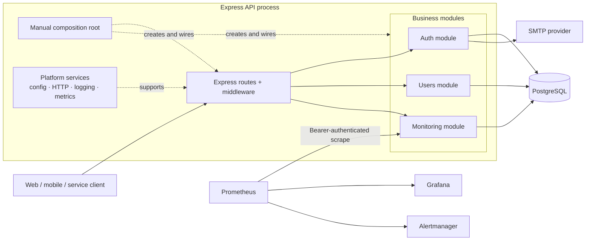

## Dependency rule

Dependencies point inward toward business behavior. Business logic does not import Express,
Drizzle, PostgreSQL, Nodemailer, Pino, or Prometheus.

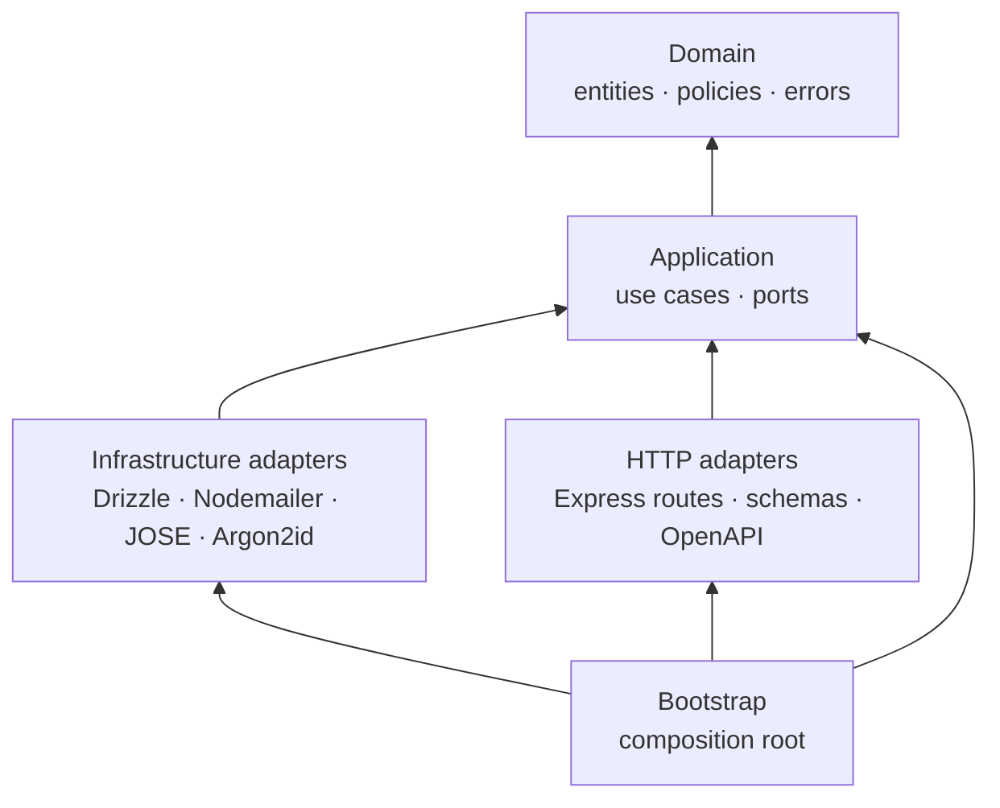

The bootstrap layer may import everything because its job is assembly. A use case may import a
domain type and a port, but not a concrete database repository.

## Repository layout

```text
src/
├── bootstrap/
│   ├── composition-root.ts     # creates and connects all runtime objects
│   ├── create-app.ts           # Express route topology
│   ├── server.ts               # process entry point
│   └── shutdown.ts             # graceful resource shutdown
├── modules/
│   ├── auth/
│   │   ├── domain/             # auth policies and errors
│   │   ├── application/        # use cases and ports
│   │   ├── http/               # Express adapter and OpenAPI
│   │   └── infrastructure/     # PostgreSQL, email, token, password adapters
│   ├── users/
│   │   ├── domain/
│   │   ├── application/
│   │   ├── http/
│   │   └── infrastructure/
│   └── monitoring/
│       ├── application/
│       └── http/
└── platform/
    ├── config/                 # validated runtime configuration
    ├── database/               # one process-wide Drizzle/PostgreSQL connection
    ├── http/                   # shared middleware and response conventions
    └── observability/          # structured logging and metrics
```

## Request flow

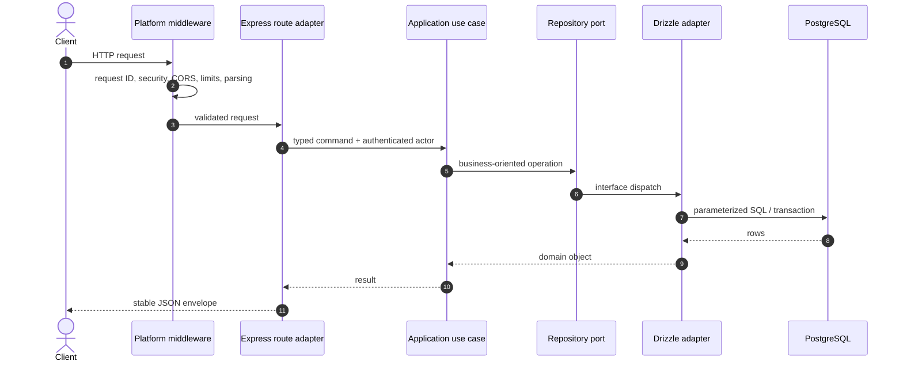

The route adapter knows HTTP. The use case knows the business operation. The repository adapter
knows persistence. Keeping those responsibilities separate makes each part easier to test and
replace.

## Ports and adapters by example

The following snippets are intentionally shortened. The source files are the authority.

### 1. Application defines the capability it needs

```ts
export interface UserRepository {
  findById(id: string): Promise<User | null>;
  create(input: CreateUserRecord): Promise<User>;
  updateName(id: string, name: string, updatedAt: Date): Promise<User | null>;
}
```

This is a port. It describes useful business-facing operations, not generic database methods such
as `query()` or `save(anything)`.

### 2. A use case depends on the port

```ts
export class GetUser {
  constructor(private readonly users: UserRepository) {}

  async execute(actor: UserActor, userId: string): Promise<UserView> {
    if (actor.role !== "admin" && actor.userId !== userId) {
      throw new UserOperationForbiddenError();
    }

    const user = await this.users.findById(userId);

    if (!user) {
      throw new UserNotFoundError();
    }

    return toUserView(user);
  }
}
```

The use case can be tested with an in-memory fake or a small mock. It does not need Express or a
database.

### 3. Infrastructure implements the port

```ts
export class DrizzleUserRepository implements UserRepository {
  constructor(private readonly db: Database) {}

  async findById(id: string): Promise<User | null> {
    const [row] = await this.db
      .select()
      .from(users)
      .where(eq(users.id, id))
      .limit(1);

    return row ? toDomain(row) : null;
  }
}
```

Drizzle stays at the infrastructure edge. Replacing PostgreSQL would require a new adapter, not a
rewrite of every use case.

### 4. The composition root wires concrete objects

```ts
const users = new DrizzleUserRepository(database.db, metrics);
const userUseCases = createUserUseCases(users);

const usersRouter = createUsersRouter({
  authenticate,
  useCases: userUseCases,
});
```

Module factories own their complete use-case sets; the composition root supplies concrete adapters
and runtime configuration. Object construction remains visible without duplicating every
constructor call or using hidden global lookups.

## Manual dependency injection versus a DI container

Both approaches are dependency injection. The difference is **who builds the object graph**.

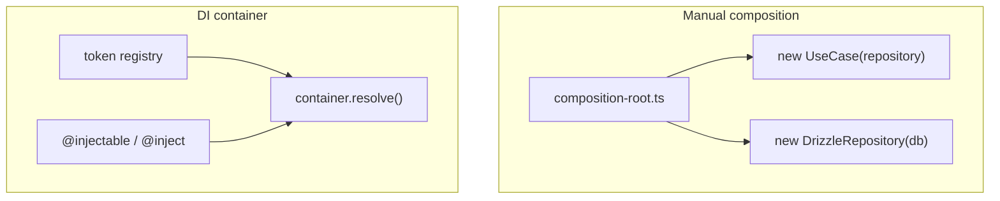

| Concern | Manual composition root | DI container |
|---|---|---|
| Wiring visibility | Explicit and searchable | Partly indirect through tokens/metadata |
| Type safety | Normal constructor typing | Depends on container and token design |
| Runtime failure risk | Low; missing arguments fail during development | Mis-registration may fail during startup/runtime |
| Boilerplate | More constructor calls | More registration/decorator setup |
| Refactoring | IDE follows direct references | String/symbol tokens can hide relationships |
| Large object graphs | Can become verbose | Convenient auto-resolution |
| Framework coupling | None | Application adopts a container convention |
| Testing | Instantiate directly | Often requires container overrides |

Manual composition is selected because this codebase has a manageable object graph and values
explicitness. A container becomes attractive when wiring is genuinely repetitive across hundreds
of independently assembled components or when runtime plugin discovery is required.

## Startup and shutdown ownership

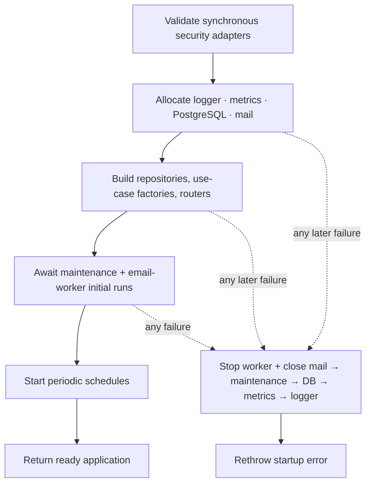

Every allocated process-wide resource is registered with one closer immediately after creation.
Intervals start only after all construction and initial work succeed. This means a late startup
exception cannot strand a PostgreSQL pool or background timer.

Signal and fatal-error handlers are installed before `listen()`, so even the startup bind window has
a cleanup owner. During shutdown, HTTP receives half of one total deadline; unused time flows to
resource draining. Lingering sockets are then force-closed, SMTP operations have explicit socket
timeouts, and a stuck resource close is raced against the remaining process deadline. The hard-exit
fallback therefore cannot hang for a transport library's much longer default timeout.

## Why a modular monolith

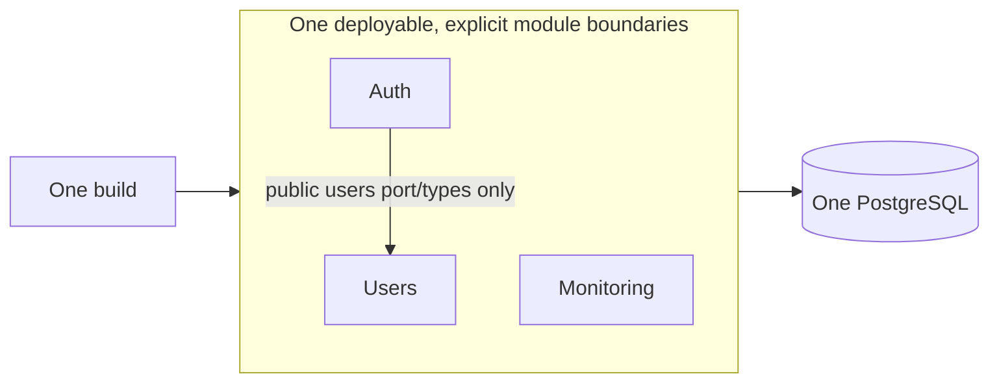

Benefits:

- One deployment, one local environment, and one transaction boundary.
- Module ownership without network calls between every capability.
- Refactoring across modules remains straightforward.
- Operational cost is much lower than microservices.
- A module can later be extracted when evidence justifies it.

Costs:

- A process failure or deployment affects the whole API.
- Module boundaries require discipline because the compiler cannot prevent every internal import.
- Scaling is process-wide even if one capability is hotter than the others.
- Long-running work should move to a worker rather than block the API process.

## Architecture options and trade-offs

| Architecture | Best fit | Advantages | Disadvantages |
|---|---|---|---|
| Traditional layered monolith | Small CRUD applications | Familiar, quick to begin, few concepts | Layers often become globally coupled; business modules blur together |
| Modular monolith (selected) | Most new product APIs and teams | Simple operations, cohesive modules, easy transactions, extractable boundaries | Requires boundary discipline; scales as one deployment |
| Hexagonal / ports and adapters (selected internally) | Business rules that must outlive frameworks | Testable core, replaceable adapters, explicit dependencies | More interfaces and mapping code than direct framework calls |
| Clean architecture | Complex, long-lived business systems | Strong dependency rule and policy isolation | Can become ceremony-heavy if every trivial operation gets many layers |
| Microservices | Independently scaling domains owned by autonomous teams | Independent deploy/scale/failure boundaries | Distributed transactions, latency, duplicated platform work, much harder operations |
| Event-driven architecture | Asynchronous workflows and loose coupling | Resilient producers, fan-out, temporal decoupling | Eventual consistency, schema evolution, retries, ordering, observability complexity |
| CQRS | Read/write models with very different scale or shape | Purpose-built models and query performance | Duplication, synchronization lag, more infrastructure and mental overhead |
| Serverless functions | Spiky, short-lived, independently triggered work | Scale-to-zero and managed runtime operations | Cold starts, connection management, vendor constraints, fragmented local development |

These are not mutually exclusive. This project uses a modular monolith as the system shape and
ports-and-adapters as its internal dependency style. It can add events, workers, or CQRS projections
only where a concrete use case benefits.

## PostgreSQL and Drizzle

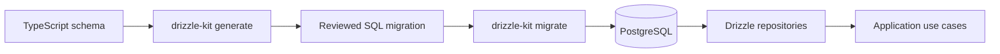

Principles:

- Migration SQL is generated, reviewed, and committed.
- Production startup does not silently push schema changes.
- One pool is created in the composition root and closed during graceful shutdown.
- Multi-row invariants use database transactions.
- Uniqueness, format, and state consistency also have database constraints.
- Repository methods expose domain operations rather than leaking Drizzle query builders.

### Concurrent administrator safety

Role and status mutations take one transaction-scoped PostgreSQL advisory lock:

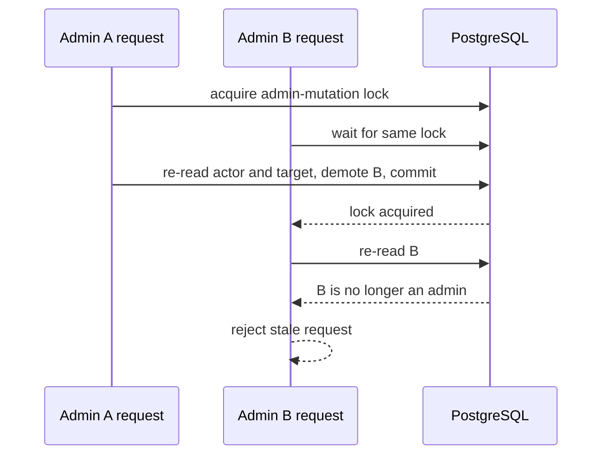

This prevents two administrators from concurrently demoting each other to zero active
administrators. An administrator may demote or disable themselves when another active administrator
remains; the invariant is the count, not actor identity. Checking only the JWT or only performing a
pre-query count would be race-prone.

## Authentication lifecycle

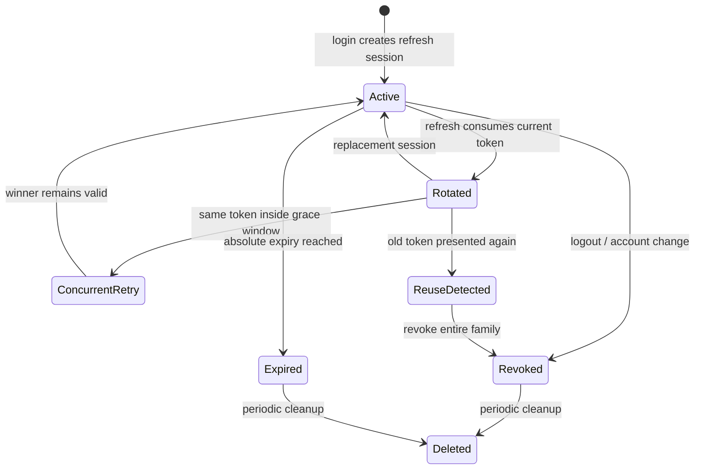

- Access tokens are short-lived signed JWTs. A token from another tab remains valid only for a brief,
  configured period after its refresh session rotates; every other revocation reason rejects
  immediately.
- Refresh tokens are random opaque values; only hashes are stored.
- Rotation is atomic and preserves the original absolute session expiry.
- A brief concurrent-refresh grace returns a retryable conflict without revoking the winner.
- Reuse detection revokes the token family.
- Password, role, status, and logout-all changes invalidate prior credentials with `authVersion`.
- Verification and reset tokens are single-use, hashed, purpose-bound, and expiring.
- Passwords require at least 12 characters plus lowercase, uppercase, number, and special-character
  classes, are capped at 1024 UTF-8 bytes, and are hashed by native asynchronous Argon2id work.
- Expired session/action rows are swept at startup and on `AUTH_CLEANUP_INTERVAL`.

Password reset has one database commit boundary:

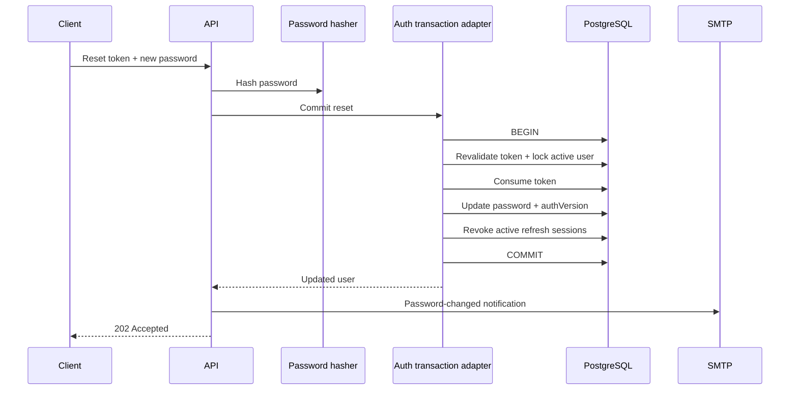

Any database failure rolls back all three security mutations. Notification delivery is post-commit
and best-effort, so SMTP failure cannot misreport the reset outcome.

Registration, password-reset, and verification-resend delivery use a PostgreSQL-backed request
queue. Registration compensates only when the durable enqueue itself fails; it does not wait for
SMTP, and an SMTP outage is retried without deleting the new account. Registration replaces any
earlier resend row for that address so a pre-registration request cannot suppress the required
verification message.

Every syntactically valid resend/reset address follows the same enqueue path and receives the same
`202`; account lookup, token issuance, and SMTP delivery happen in a retrying worker. A unique
recipient/purpose row enforces a durable cooldown across API replicas and bounds triggered email
volume. Every claim receives a database-generated lease ID; completion and retry updates require both
the row ID and current lease ID. A stale replica therefore cannot overwrite work reclaimed by another
replica. SMTP timeouts are much shorter than the stale-claim window. Completed-row cleanup runs at
the cooldown cadence rather than on every worker poll.

Delivery is intentionally at-least-once: SMTP and PostgreSQL cannot share a transaction. Lease
ownership prevents stale state writes, while provider-side idempotency is still required if a
deployment needs stronger duplicate suppression after a process dies immediately after SMTP accepts
a message.

## Monitoring and failure boundaries

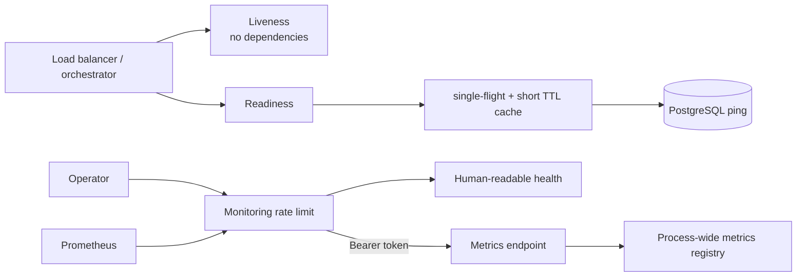

- Liveness only answers whether the process can serve HTTP.
- Readiness checks PostgreSQL, but concurrent callers share one in-flight check and a short cache.
- Liveness and readiness bypass IP quotas so normal orchestrator cadence cannot produce `429`.
- Health, metrics, and alert-webhook traffic has a separate request quota from the application API.
- Metrics require a constant-time-compared bearer token.
- Prometheus uses normalized route templates, never user IDs or raw URLs as labels.
- Logs redact passwords, cookies, authorization headers, secrets, tokens, sensitive URL parameters,
  and SQL parameters embedded by database error wrappers.
- API responses use a deny-by-default CSP, `X-Frame-Options: DENY`, an explicit safe legacy-XSS
  setting, and a restrictive Permissions Policy. The docs adapter replaces the API CSP with the
  narrowly expanded policy its UI requires.

The built-in rate-limit store is process-local. Verification resend requests first consume a
per-client budget and then a normalized client-plus-recipient budget. Rotating recipients cannot
bypass the client cap, and one client cannot consume another client's recipient quota. Deployments
with multiple API replicas should use a shared store so those limits are consistent across replicas.
Feature routers mount their policies beside the route declarations, so a protected route cannot
silently drift away from a separate bootstrap path list. Email-request cooldowns and worker leases
are PostgreSQL-backed and therefore already shared.

## Deployment topology

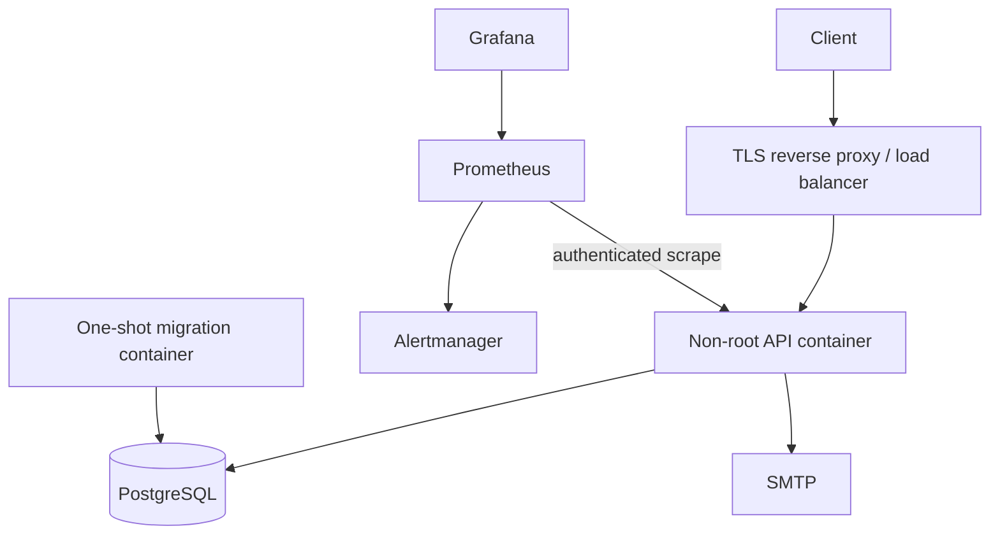

The API image contains compiled production code and production dependencies. Migrations run as a
separate one-shot service before the API starts. Health checks gate service readiness, and graceful
shutdown stops accepting work before closing mail, metrics, logging, and database resources within
one bounded process deadline.

## Testing strategy

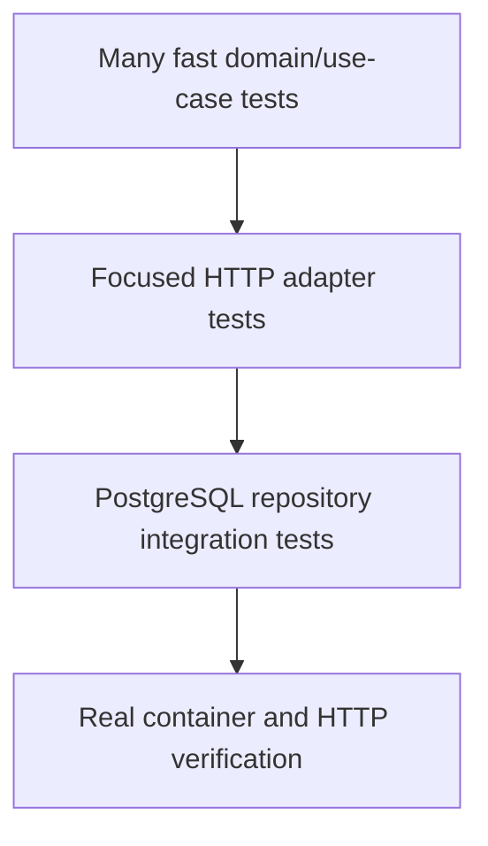

- Unit tests cover policies, use-case ordering, error behavior, and concurrency coordination.
- HTTP tests cover validation, error envelopes, rate-limit semantics, and monitoring auth.
- Integration tests use real PostgreSQL for query behavior and concurrent admin mutations.
- Runtime verification checks the built image, migrations, health endpoints, Prometheus target, and
  Grafana datasource.

## Evolution guide

Keep the modular monolith until a measurable constraint appears. Extract a module only when it has:

- a clear data-ownership boundary;
- a team that can own deployment and operations;
- materially different scaling or availability requirements; and
- enough value to justify network failure, tracing, retries, and eventual consistency.

Before microservices, less expensive steps often solve the problem:

1. Add a background worker for slow or retryable jobs.
2. Add a transactional outbox for durable events/email.
3. Add caching or read replicas for read pressure.
4. Scale identical API replicas behind a load balancer.
5. Extract only the proven bottleneck or independently owned capability.
